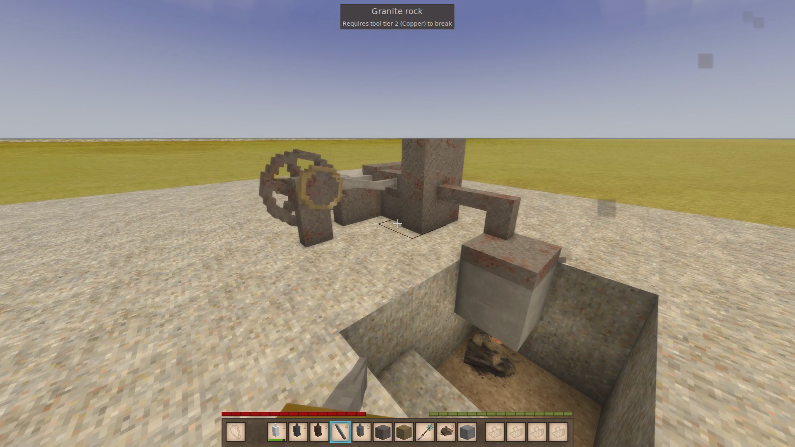

# Pogon

A Vintage Story mod where steam engines actually work.
Build machines out of chiseled blocks, glue them into moving parts joined by hinges and sliders, and drive them with steam that fills the real space inside them and pushes on what it touches.

**Status:** work in progress, not released. Single-player only so far.

Recent work is being reviewed and cleaned up before it lands here, so this branch is behind what the video shows. Each system goes up as it's ready.

Bug reports and ideas are welcome as issues.
